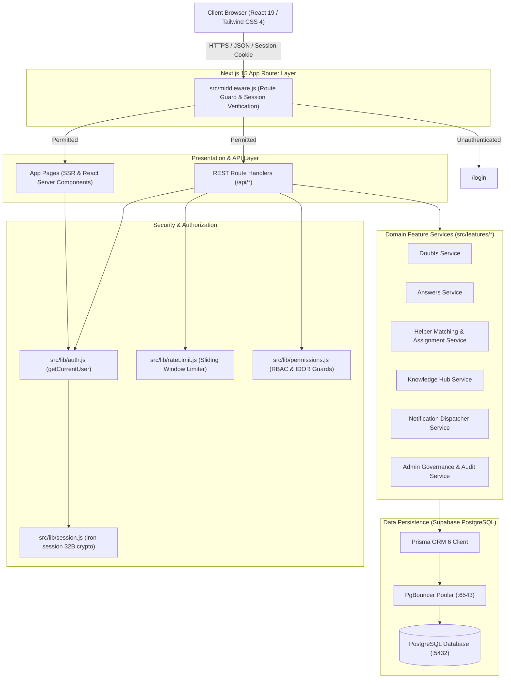
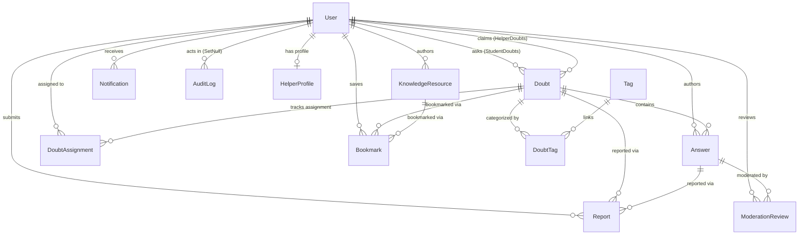
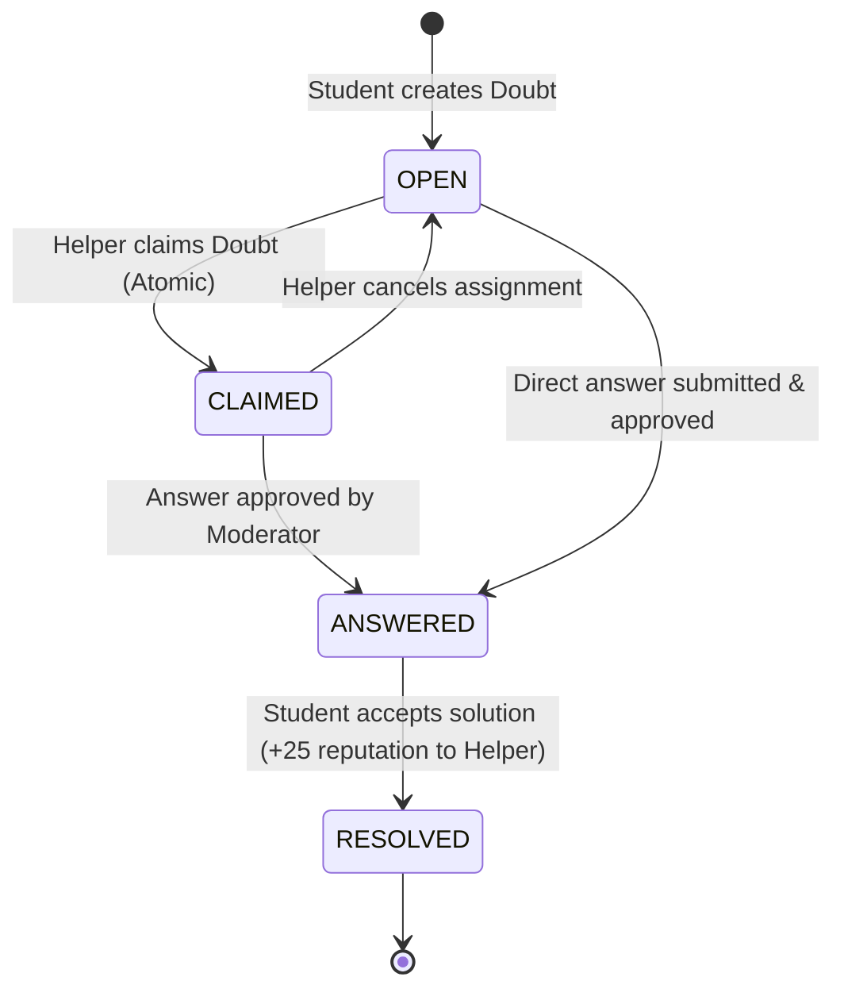
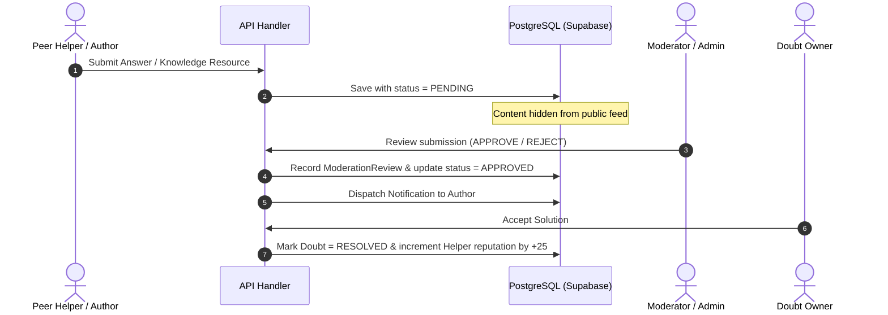

# DoubtBridge System Architecture

## 1. High-Level System Architecture

DoubtBridge is a Peer-to-Peer Academic Doubt Resolution Platform engineered using modern web architectures: Next.js 15 App Router, React 19, Prisma ORM 6, PostgreSQL (Supabase with PgBouncer connection pooling), Tailwind CSS 4, and iron-session for stateless encrypted cookie authentication.



---

## 2. Directory & Module Organization

The codebase follows a modular feature-driven architecture that separates Next.js presentation, API transport handlers, domain business logic, and security authorization:

```
DoubtBridge/
├── prisma/
│   ├── schema.prisma              # Database schema definitions and relations
│   ├── migrations/                # Version-controlled SQL migrations
│   │   ├── 20261029060014_init_doubtbridge/
│   │   └── 20261113000000_audit_and_hardening/
│   └── seed.js                    # Database seed script for development/demo
├── src/
│   ├── app/                       # Next.js 15 App Router
│   │   ├── (auth)/                # Auth route group: /login, /register
│   │   ├── (dashboard)/           # Protected dashboard route group
│   │   │   ├── dashboard/         # Multi-role analytics overview
│   │   │   ├── doubts/            # Doubt feed, detail, and submission
│   │   │   ├── helpers/           # Peer helper matching and assignments
│   │   │   ├── knowledge/         # Knowledge Hub articles and bookmarks
│   │   │   ├── notifications/     # Notification activity center
│   │   │   └── admin/             # Admin management & control center
│   │   └── api/                   # REST API route handlers
│   ├── components/                # Modular React UI components
│   │   ├── admin/                 # Control center tables, badges, stats
│   │   ├── dashboard/             # Role stats cards, charts, activity stream
│   │   ├── doubts/                # Doubt cards, filters, answers, forms
│   │   ├── helpers/               # Helper cards, matching display, assignments
│   │   ├── knowledge/             # Article reader, editor, bookmark button
│   │   ├── layout/                # Navbar, Sidebar, UserMenu, Bell icon
│   │   └── notifications/         # Notification items, mark-read controls
│   ├── features/                  # Domain business logic & services
│   │   ├── admin/                 # Admin metrics, user governance, audit logging
│   │   ├── answers/               # Answer creation, moderation, acceptance
│   │   ├── dashboard/             # Role-tailored analytics aggregations
│   │   ├── doubts/                # Doubt queries, search, status transitions
│   │   ├── helpers/               # Matching engine (100pt), atomic claims
│   │   ├── knowledge/             # Articles, review queues, bookmarks
│   │   └── notifications/         # Event dispatchers, unread badges
│   ├── lib/                       # Core infrastructure & security libraries
│   │   ├── auth.js                # Session-to-user resolution
│   │   ├── permissions.js         # RBAC rules, role escalation prevention
│   │   ├── session.js             # iron-session cryptographic cookie config
│   │   ├── rateLimit.js           # Sliding window brute-force defense
│   │   ├── prisma.js              # Singleton Prisma client instance
│   │   └── utils.js               # Common formatting and helpers
│   └── middleware.js              # Edge route guard verifying session cookies
├── tests/                         # Node.js built-in automated test suite
│   ├── loader.mjs                 # ESM path resolution hook
│   ├── register.mjs               # Module registration bootstrap
│   ├── unit/                      # Isolated unit tests (RBAC, RateLimit, Session)
│   └── integration/               # Database integration tests across 8 modules
└── docs/                          # Comprehensive technical documentation
```

---

## 3. Database Schema & Relational Model

The PostgreSQL schema is managed via Prisma ORM 6 and incorporates strict referential integrity, composite unique constraints, indexes for query performance, and audit preservation:



### Key Models & Safeguards

- **`User`**: Central identity with `role` (`STUDENT`, `HELPER`, `MODERATOR`, `ADMIN`), `reputation` counter, `isActive` account status flag, and `suspensionReason`.
- **`AuditLog`**: Append-only administrative governance log. Features `actorId String?` with `onDelete: SetNull` foreign key constraint, alongside frozen identity snapshots (`actorEmail`, `actorName`, `actorRole`). When an administrator is deleted, the historical audit log survives.
- **`Bookmark`**: Features composite unique constraints `@@unique([userId, doubtId])` and `@@unique([userId, resourceId])` ensuring duplicate saves are prevented at the database engine level.
- **`DoubtAssignment`**: Tracks helper claims and active workload limits (`WORKLOAD_LIMIT = 5`).
- **`Answer`**: Transitions from `PENDING` -> `APPROVED` / `REJECTED` via `ModerationReview`.

---

## 4. Workflows & State Machines

### Doubt Lifecycle & Solution Acceptance


### Content Moderation Workflow


### 100-Point Helper Matching Engine
The rule-based matching engine calculates relevance in real-time:
1. **Self-Exclusion**: If helper created the question -> **Ineligible (0 pts)**.
2. **Workload Guard**: If helper has $\ge 5$ active assignments -> **Ineligible (0 pts)**.
3. **Availability Filter**: If helper is marked unavailable -> **Ineligible (0 pts)**.
4. **Availability Bonus**: If active and available -> **+20 points**.
5. **Subject Match**: If helper subjects match doubt subject -> **+30 points**.
6. **Topic / Keyword Match**: If helper expertise matches doubt topic or description -> **+50 points**.
7. **Score Bounds**: Capped at **100 points maximum**.
